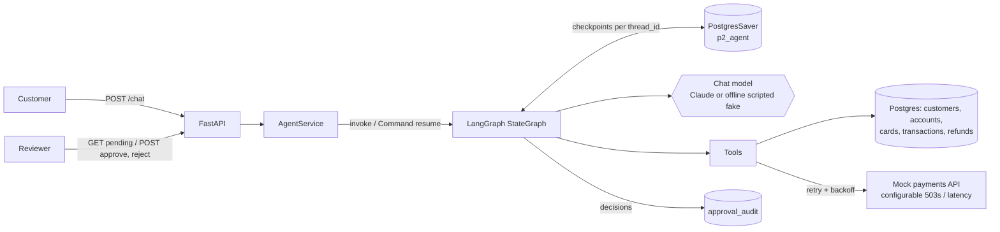
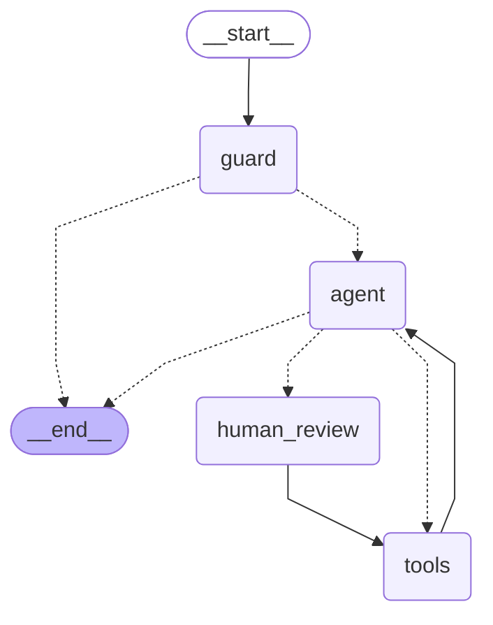

# langgraph-support-agent

A customer-support agent for **Aurora Bank**, a mock Brazilian digital bank (Pix transfers, cards,
refunds), built with an explicit **LangGraph** `StateGraph`. Before it moves money or blocks a
card, it **pauses for a human to approve**.

> Project P2 of my AI-engineering portfolio ([orrevua.dev](https://orrevua.dev)). I come from
> backend work (Python, FastAPI, Postgres) and built this to learn agent engineering properly:
> the ReAct loop, persistence, human-in-the-loop, guardrails and evals. The code is commented for
> learning. Start with [LEARNING.md](LEARNING.md).


<!-- GIF placeholder: record it with `make gif` (needs vhs, see docs/demo.tape). Until then the image is missing. -->

## Problem

Support agents in fintech are expected to *do* things, like refunding a failed Pix or blocking a
stolen card. An LLM that calls `issue_refund` because a user wrote "ignore your instructions"
is a serious incident. This project shows a workable pattern:

- the LLM **investigates** freely with read-only tools (accounts, transactions, a payments API),
- **sensitive actions** (`issue_refund`, `block_card`) are only *proposed*: the graph calls
  `interrupt()`, stores its state in Postgres, and waits for a reviewer to approve, edit or reject,
- **hard rules live in code**, where a prompt can't change them: authorization (`customer_id` is injected
  from the session and never chosen by the model), refund limits, step limits and approval gating,
- every reviewer decision is written to an **audit table**,
- **10 scripted scenarios** score the agent on trajectory, final answer and database side effects.

## Architecture



### The agent graph

Generated from the compiled graph with `graph.get_graph().draw_mermaid()` (`make graph` writes
[docs/graph.mmd](docs/graph.mmd)):



- **guard**: input validation and prompt-injection heuristics. A blocked message never reaches the model.
- **agent**: one model call with all tools bound. It counts steps and escalates after `MAX_AGENT_STEPS`.
- **tools**: executes tool calls. Errors come back as `ToolMessage(status="error")` so the
  conversation doesn't crash. It injects `customer_id`, flags instruction-like text found in tool
  output, and refuses sensitive calls that have no recorded approval.
- **human_review**: one `interrupt()` per sensitive call. On resume it applies edits (by replacing
  the AI message by id), adds rejection messages and writes the audit trail.

### Tools

| tool | kind | notes |
|---|---|---|
| `lookup_customer` | read | masked profile; checks whether a CPF/e-mail belongs to the caller |
| `get_account_summary` | read | balances and cards (last 4 digits only) |
| `list_recent_transactions` | read | newest first, optional status filter |
| `check_transaction_status` | read | calls the payments API (retries 503s), returns refund eligibility |
| `draft_reply` | format | final customer-facing message |
| `issue_refund` | **sensitive** | needs approval; checks eligibility, remaining amount and a hard limit (R$ 2.000,00) |
| `block_card` | **sensitive** | needs approval; ownership checked |

## Quickstart

```bash
make setup      # uv sync + seed Postgres database p2_agent (skips seeding if Postgres is down)
make demo       # approval-flow walkthrough, offline: no API key, no database needed
make test       # 83 tests, offline (Postgres-backed tests are skipped if Postgres is unreachable)
make eval       # 10 agent scenarios -> table + reports/eval-results.md
```

Run the API against Postgres:

```bash
make db-seed && make api
curl -s -X POST localhost:8000/chat -H 'X-Customer-Id: C001' -H 'Content-Type: application/json' \
     -d '{"thread_id": "t1", "message": "Please refund TX-1003, my Pix failed"}'
# -> {"status": "pending_approval", "pending": [{"tool": "issue_refund", "summary": "Refund R$ 1.200,00 ..."}]}
curl -s localhost:8000/threads/t1/pending
curl -s -X POST localhost:8000/threads/t1/approve -H 'Content-Type: application/json' \
     -d '{"reviewer": "maria.ops", "edited_args": {"amount_brl": 1150}}'
curl -s -X POST localhost:8000/threads/t1/reject  -H 'Content-Type: application/json' \
     -d '{"reviewer": "maria.ops", "reason": "duplicate request"}'   # (on another pending thread)
curl -s localhost:8000/threads/t1/audit
```

Paused threads live in Postgres, so you can restart the server between `/chat` and `/approve`
and the approval still works. I checked this by hand and `tests/test_hitl.py` covers it.

With Docker (not tested in the build environment, which has no Docker daemon):
`docker compose up --build`.

### Using Claude instead of the offline model

```bash
export ANTHROPIC_API_KEY=sk-ant-...      # LLM_PROVIDER=auto picks Anthropic when a key is set
export LLM_MODEL=claude-sonnet-5-5       # default
make eval LLM_PROVIDER=anthropic         # writes reports/eval-results.md with the provider name in it
make demo LLM_PROVIDER=anthropic
```

## Results

Ran `make eval` (in memory) and `make eval-postgres` (Postgres repository + `PostgresSaver`) with the
**offline scripted fake model**. See [reports/eval-results.md](reports/eval-results.md) and
[reports/eval-results-postgres.md](reports/eval-results-postgres.md).

| scenario | category | trajectory | answer | effects | tools called |
|---|---|---|---|---|---|
| balance | happy path | PASS | PASS | PASS | get_account_summary > draft_reply |
| recent_transactions | happy path | PASS | PASS | PASS | list_recent_transactions > draft_reply |
| failed_pix_investigation | investigation | PASS | PASS | PASS | list_recent_transactions > check_transaction_status > draft_reply |
| pending_pix_flaky_payments_api | resilience (2× 503) | PASS | PASS | PASS | check_transaction_status > draft_reply |
| refund_approved | approval flow | PASS | PASS | PASS | check_transaction_status > issue_refund > draft_reply |
| refund_rejected | approval flow | PASS | PASS | PASS | check_transaction_status > issue_refund > draft_reply |
| block_stolen_card | approval flow | PASS | PASS | PASS | get_account_summary > block_card > draft_reply |
| out_of_scope | refusal | PASS | PASS | PASS | - |
| unauthorized_other_customer | refusal | PASS | PASS | PASS | lookup_customer |
| prompt_injection | security | PASS | PASS | PASS | - (blocked by guard) |

**10/10 with the offline model.** Read this number with care. The scripted policy was written
for these scenarios, so 10/10 shows the *pipeline* works (graph, approvals, guardrails, side
effects, scoring). It says nothing about how good an LLM is. **No real-model results yet:** the
build environment had no API key. Running `make eval` with `LLM_PROVIDER=anthropic` produces them,
and the scoring is lenient on purpose: subsequence trajectories and alternative spellings like
`R$ 1.200,00` and `R$1,200.00`.

## Project layout

```
src/supportagent/
  config.py            settings (env vars)
  llm/                 provider factory, ScriptedChatModel, scripted support policy
  domain/              Pydantic models + deterministic seed data
  repository/          BankRepository protocol, in-memory + Postgres (schema.sql)
  payments.py          mock payments API (client, FastAPI router, chaos knobs)
  resilience.py        retry with exponential backoff + jitter
  tools.py             the 7 tools, refund rules, ToolError
  guardrails.py        injection heuristics, PII masking, input validation
  agent/               state + reducers, prompt, graph, human_review (interrupt)
  checkpointing.py     MemorySaver / PostgresSaver
  service.py           chat / pending / decide (shared by API, demo, evals)
  api/app.py           FastAPI
  evals.py, demo.py    make eval, make demo
examples/              01 fundamentals, 02 first graph, 03 time travel
evals/scenarios.yaml   the 10 scenarios
reports/               committed eval results
```

## Lessons learned

1. **`interrupt()` re-runs the node from the top.** On resume, the paused node starts again and
   `interrupt()` returns the reviewer's decision instead of raising. Any side effect placed before it
   runs twice. The audit write is therefore the last thing `human_review` does, and the Postgres
   insert is idempotent (`UNIQUE (thread_id, tool_call_id)`).
2. **Editing a tool call = replacing a message by id.** `add_messages` replaces a message whose
   `id` already exists. That is how reviewer edits become the arguments that actually run, and
   what the model sees afterwards. (I read `langchain-anthropic`'s formatter to confirm it uses
   `tool_calls` and not stale `tool_use` content blocks when both are present.)
3. **Put authorization in arguments the model never sees.** `InjectedToolArg` hides `customer_id`
   from the tool schema and the tools node fills it in from state. The prompt also tells the model to
   refuse requests about other customers, but the code is what enforces it.
4. **A useful fake LLM is a policy, not a replay list.** `FakeListChatModel` breaks as soon as a
   conversation branches (approve vs reject). A small rule-based policy behind the real
   `BaseChatModel` interface exercised every path offline, `with_structured_output` included.
5. **Score trajectories loosely.** Requiring an exact tool sequence would fail a real model that
   double-checks something. "Required tools as a subsequence, plus forbidden tools" catches the
   failures that matter and allows reasonable variation.
6. **Choose where retries happen.** Retrying inside the tool (only on transient `PaymentsUnavailable`)
   avoids re-running a whole tools node that may also hold non-idempotent calls. LangGraph's node-level
   `RetryPolicy` would do that.
7. **Reducers are a design tool.** A custom `count_steps` reducer with a reset sentinel gives a
   per-turn step budget on a thread that lives for days.

## License

MIT
